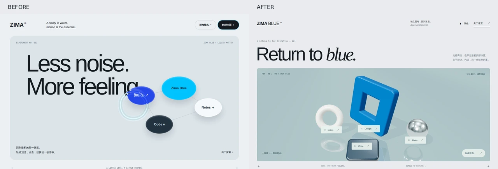

# Zima Blue：视觉与触觉原型重设计

版本：2026-10-17。范围：`scratch/prototype`。此文替代旧规范，作为本轮实现与实拍评审的唯一依据；正式博客接入另行处理。

## 1. 过去踩过的坑

- **先写公式，后看画面。** 先前多轮只跑 CPU 数学与模拟 GL 检查，没有在真实浏览器中编译、截图和操作。测试通过无法证明好看。
- **把几种材质混为一谈。** 从厚胶环改到细波纹，再叠加虹彩、焦散和蓝色吸收，缺少稳定的视觉主体。浮点精度能改善离散误差，不能自动创造材质。
- **误读 Lusion。** 它的立体装置有真实几何、环境光和材质；全局鼠标效果是速度场反馈与输运。把两者统称为“粘稠水波”，导致一直在调同心圆。
- **把全站 DOM 折射当成透明覆盖层的现成功能。** WebGL 不能直接读取下方浏览器合成结果。手工重画 DOM 文字会产生字体、基线、换行和样式偏差，不能扩展成文章渲染器。
- **旧规范不断追加互相矛盾的定稿。** “强彩虹”“薄水”“厚胶”“全站折射”“保护阅读”同时被承诺，还出现“绝对光滑”“所有设备 60fps”“0% 占用”等未经测量的保证。本轮取消这些保证，以实拍结果和明确边界替代。

## 2. 研究对象与可复用的做法

研究时区分实拍、公开源码和推断，避免仅凭品牌印象写建议。

| 参考 | 观察与公开实现依据 | 在本原型中的转化 |
| --- | --- | --- |
| [Lusion](https://lusion.co/) / [Awwwards Lusion v3](https://www.awwwards.com/sites/lusion-v3) | 2023 v3 录像以蓝、白、黑装置建立材质；2026 在线实拍的强调色已变为黄绿。两者都依靠体积、圆滑边缘和环境反射，不能把某一配色当作效果本身。公开 `ScreenPaint` 实现以低分辨率速度场、连续线段注入、反馈输运和卷曲扰动驱动后处理；装置本身另有几何和材质。 | 静止画面先成立，再用有方向、可衰减的流动推动已有画面。学习分层方法，自己制作齐马蓝装置，不复制十字模型或贴图。 |
| [Active Theory](https://activetheory.net/) | 在线站在云端返回“不支持此浏览器”。因此改看其 Awwwards v6 官方录像：空间中的玻璃雕塑与粒子构成背景，作品卡片、导航和说明保留清楚的前后层次；进入作品时发生有组织的空间转换。这里的结论来自录像，不冒称已操作在线完整体验。 | 借鉴前后层次与主次分配：原生导航保持清楚，场景承担视觉冲击，文字不跟着背景材质一起碎裂。博客不复制它的持续粒子动画与重型空间导航。 |
| [OGL fluid distortion](https://oframe.github.io/ogl/examples/post-fluid-distortion.html) / [源码](https://github.com/oframe/ogl/blob/master/examples/post-fluid-distortion.html) | 速度输运、旋度和压力求解推动真实场景采样。流动随手势方向变化，效果不依靠画出有色圆线。技术演示，不作为商业网站排名依据。 | 本轮选低成本的输运 flowmap，不冒称完整 Navier–Stokes 求解。 |
| [OGL mouse flowmap](https://oframe.github.io/ogl/examples/mouse-flowmap.html) / [Flowmap 源码](https://github.com/oframe/ogl/blob/master/src/extras/Flowmap.js) | 128² 量级的反馈纹理保存速度和强度，移动时注入，停止时衰减；有纹理和明暗结构的底图让折射可见。 | 连续线段注入、低分辨率双缓冲、时间步长校正、停止后回到原场景。 |
| [Evan Wallace WebGL Water](https://madebyevan.com/webgl-water/) / [源码](https://github.com/evanw/webgl-water) | 水的说服力来自池壁、格线、反射、折射和空间关系共同作用。高度场只是其中一环。 | 保留表面的尺度线索与装置倒影；点击波仅辅助局部触感，避免把整页染成发光油膜。 |

Active Theory 录像依据：[Awwwards v6 页面](https://www.awwwards.com/sites/active-theory-v6)、[首屏与作品导航](https://assets.awwwards.com/awards/element/2024/02/65c0bc8a48110839245666.mp4)、[作品展开](https://assets.awwwards.com/awards/element/2024/02/65c0bf17830be802324716.mp4)。

Lusion 研究补充：[首屏交互录像](https://assets.awwwards.com/awards/element/2023/09/6516c2abeb13c196794165.mp4)、[场景叙事录像](https://assets.awwwards.com/awards/element/2023/09/6516c112a166e447899126.mp4)。源码核对来自其公开页面加载的 `/_astro/hoisted.CUO_IjfL.js`；构建文件名可能变化。录像与源码互相校验，不声称重建了其完整内部系统。

## 3. 新视觉方案

### 3.1 静止时就值得看

采用“回到那一块蓝”的原创装置：一枚有厚度、圆润倒角的齐马蓝方形框，搭配少量陶瓷与金属形体。它们共享一个有柔和倒影、细尺度格线的水平展台。颜色控制在蓝、灰白、墨色，蓝色承担唯一的强视觉焦点。

页面顺序为简洁导航、编辑式大标题、独立装置展台、安静的中文阅读区。标题不再和椭圆按钮挤在同一块灰色面板上。节点标签对应真实场景中的物体，保持小而清楚；图谱拖动仍是可操作的原型能力。

使用真实几何、环境照明、倒角和投影建立材质。Three.js 只承担隔离展台的渲染，后处理仍是轻量屏幕空间流程；闲置时缓存场景并停止逐帧绘制。相比旧方案，这是有意增加少量场景制作成本，换取可见的体积和材质依据。

### 3.2 动态时看得出方向

- **悬停滑动：** 连续线段将速度写入 flowmap；场随自身速度输运并轻微卷曲。手从左到右划过时，结构应朝同一方向被拉开，转弯处留下柔和弯曲尾迹。
- **点击：** 产生一次局部扩散的透镜波。宽度与对比受控，主要看格线、倒影和物体轮廓的形变；不额外画亮蓝圆圈。
- **节点：** 主动拖动改变装置位置，同时注入方向流；键盘方向键也能移动。初始布局与窗口重排不激发水波。
- **停止：** 尾迹逐渐减弱，约 1.5 秒量级停止反馈；清空流场并绘回完全相同的静止场景，避免依靠隐藏画布掩盖接缝。
- **光学：** 主效果是已有场景的位移采样。色散只在位移边缘提供微量分光；不把虹彩轮廓当作水体。反射来自场景照明与展台倒影。

### 3.3 交互边界

本轮优先验证装置场景中的真实折射与全页视觉层级。标题、按钮标签、正文均为原生 DOM，可以选中、聚焦和缩放。正文不再被一个近似文字副本覆盖。整站其他页面未来只能在具有明确场景纹理的图像、背景或自绘图谱表面接入；“任意 DOM 全站强折射”保留为未解决的技术决策，不冒称已经实现。

不再将滚动自动注入全屏水体。滚动首先服务内容浏览；鼠标和节点的主动操作才产生触觉反馈。深色主题使用深蓝展台、清楚的蓝白装置与低调反射，取消生物荧光定位。

## 4. 实现边界与资源策略

1. 统一渲染器：三维场景先渲染到场景纹理，再通过 flowmap 后处理输出。没有 DOM 截图、文字镜像、背景色遮盖拼接。
2. flowmap：低分辨率双缓冲，优先可渲染半浮点；能力不足使用编码速度的 RGBA8。RGBA8 仅承担平滑位移，不做会放大量化误差的高度导数高光。
3. 本轮是带惯性的 flowmap 近似，不是完整流体物理。展台反射与场景光照也不等于真实水体路径追踪。
4. 场景只在尺寸、主题或物体位置改变时重绘；动态期间只更新流场与合成。像素比与渲染尺寸设上限。软件 GPU 的截图不能作为真机帧率证据。
5. 切后台、移出可见区域、页面离开时停止 RAF；恢复时清空旧手势。reduced-motion 保留静态装置与普通交互，不持续位移；无 WebGL 或上下文丢失显示静态设计降级。
6. 库与示例文件本地固定版本并保留许可证，避免首次访问依赖第三方 CDN。生产站接入、包体积预算和真机功耗另行评审。

## 5. 云端实拍验收

GitHub Actions 仅在 `codex/zima-visual-lab` 分支运行，独立静态服务与 Chromium 软件 GPU，不部署生产网站。保存截图、录像和浏览器错误报告。

必须看见以下证据，再评价完成度：

- 桌面浅色、深色、390px 移动端的静止构图：主体完整、无文字遮挡、无横向溢出。
- 点击前后与两次不同方向滑动的画面：位移作用在真实场景，能辨识方向和回落，不是给光标加彩色描边。
- 拖动节点、键盘移动、主题切换、阅读与文本选择：原生控件可用。
- 动态停止后的画面与静止基线一致；无 WebGL、reduced-motion、上下文丢失恢复有可检查的降级结果。
- 检查 `pageerror`、失败资源、实际 canvas 尺寸和运行状态；加载失败的参考站必须明确标注。

旧原型与在线参考实拍：[Actions 38999229243](https://github.com/kikoiio/Blog/actions/runs/38999229243)。该轮已产出全部站点截图；因整批采集耗时过长主动取消并保存产物，不将其标成成功验收。旧原型点击截图可见文字破碎、圆圈高光与结构脱节，悬停形变不易察觉。Lusion、OGL fluid 与 Evan 的场景可正常观看；OGL flowmap 当时处于速度场调试显示，Active Theory 在线体验不可用。

最终原型实拍：[Actions 39001075455](https://github.com/kikoiio/Blog/actions/runs/39001075455)，结果 **success**；验证代码提交 `4fa1b1fa6b0b242d3bb71754c9070835a9439365`。截图、录像在该运行的 `visual-evidence` 附件中，保留 14 天；关键截图与[诊断报告](evidence/zima-visual-report.json)另存于仓库。

| 检查 | 本轮实际观察 |
| --- | --- |
| 构图与主题 | 桌面浅色/深色、390px 触屏仿真的浅色/深色均无横向溢出；修正了首拍中的物体重叠与蓝色过曝。 |
| 方向流动 | 默认与 `?flow=soft` 均已实拍。弱版本的形变太容易忽略，采用默认强度；左右划动使轮廓朝对应方向形变，标签保持稳定。 |
| 停止与复原 | 正常、弱流量、深色、强制 RGBA8 四组，停止后的整幅截图均与初始截图逐像素一致；额外观察 250ms，渲染帧计数不增加。 |
| 原生交互 | 桌面拖拽、方向键移动、主题切换通过；正文原生选择高亮正常。移动端检查了布局和触碰，未冒充真机长时间手势测试。 |
| 能力降级 | 强制 RGBA8、reduced-motion、无 WebGL 均完成采集。无 WebGL 的初始化错误是故意阻止上下文后的预期记录，随后静态图正常显示。 |
| 上下文恢复 | 使用真实 `WEBGL_lose_context` 扩展触发丢失与恢复；失效期间展示相同构图的静态图，恢复后重新建立场景，未再出现 `INVALID_OPERATION` 资源释放警告。 |
| 浏览器诊断 | 八组均无未捕获脚本异常、采集失败或资源加载失败；正常渲染组无 console 错误或警告。 |

[前后对比](evidence/zima-comparison.webp) · [动作分帧](evidence/zima-motion-study.webp) · [浅色](evidence/zima-after.webp) · [深色](evidence/zima-after-dark.webp) · [移动端](evidence/zima-after-mobile.webp) · [失效降级](evidence/zima-context-fallback.webp)

本轮选择：**保留具有真实材质和方向流场的装置展台，原生文字保持稳定。** 已完成隔离原型的视觉与基础交互复拍；正式 D3 集成、整站任意 DOM 折射、真实移动设备帧率和功耗仍不属于已验证成果。
